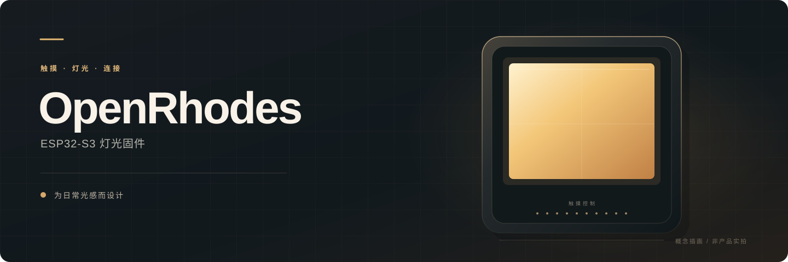
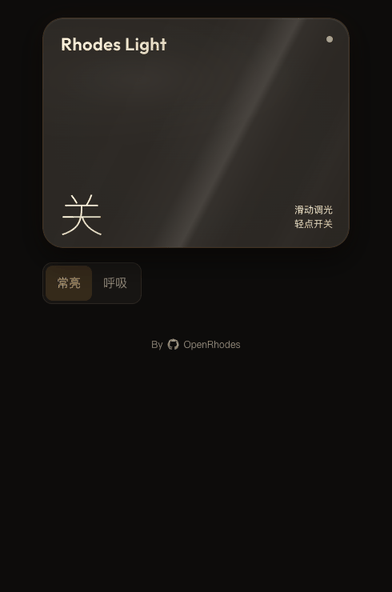
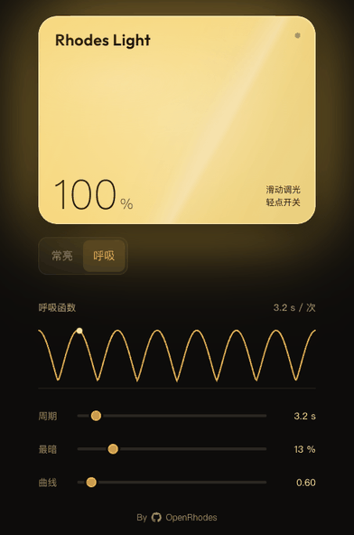

<div align="center">
  

  **让光，随触碰与节奏自然变化。**

  基于 ESP32-S3 的触摸灯固件，集成本地交互、无线配网与网页控制。

  [快速开始](#快速开始) · [功能概览](#功能概览) · [硬件与接口](#硬件与接口) · [文档导航](#文档导航) · [参与协作](#参与协作)
</div>

---

> **项目状态：开发与硬件联调阶段。** 本仓库面向团队协作，暂不提供面向最终用户的发布版、预编译固件或安装包。功能、接口和参数仍可能调整。

## 功能概览

| | 能力 | 说明 |
| :--- | :--- | :--- |
| **01** | 触摸调光 | 通过电容触摸条进行本地操作，支持滑动调节亮度。 |
| **02** | 灯光效果 | 支持平滑渐变和呼吸效果，呼吸周期、下限与曲线可调。 |
| **03** | 无线配网 | 支持热点网页和蓝牙低功耗（BLE）配网，保存多组 Wi-Fi 配置。 |
| **04** | 网页控制 | 通过设备内嵌网页或 HTTP 接口读取状态、调节灯光及管理配网。 |
| **05** | 设备发现 | 支持 mDNS 和基于站点 MAC 的设备标识；实际发现能力取决于网络环境。 |

## 网页控制演示

| 网页滑动调光 | 网页呼吸模式 |
| :---: | :---: |
|  |  |
| 在灯面上滑动，调整亮度 | 切换呼吸模式，查看波形与参数 |

<sub>以上为连接设备的 Web 页面操作录屏，并非实体灯具的实拍画面；实际灯光效果以设备表现为准。</sub>

## 快速开始

**前置条件：** Python 3 和 PlatformIO Core，或安装了 PlatformIO 扩展的 VS Code。

```sh
# 从仓库根目录进入当前固件项目
cd esp_fw

# 构建；构建前钩子会自动生成网页资源
pio run
```

普通构建不会烧录或重置设备。需要上传固件时，先确认连接的开发板和串口，再参考 [构建与烧录](esp_fw/README.md#构建与烧录)。

> **请从 `esp_fw/` 构建当前固件。** 仓库根目录的 `platformio.ini`、`src/`、`web/` 和 `tools/` 是早期固件的历史基线；在根目录构建得到的不是当前固件。

## 硬件与接口

| 项目 | 当前配置 |
| :--- | :--- |
| 开发平台 | ESP32-S3；PlatformIO `espressif32@6.13.0` |
| 触摸输入 | GPIO1–GPIO10 电容触摸通道 |
| 灯光输出 | GPIO17 控制电源轨；GPIO18 控制高边 PMOS 反相 PWM |
| 输出参数 | PWM 19 kHz、12 bit；物理占空比上限 80% |
| 网络入口 | 配网热点、局域网网页 / HTTP，以及 BLE 配网 |

硬件接线、构建配置、默认参数与完整接口表以 [固件说明](esp_fw/README.md) 和源码为准。网络控制接口目前使用显式请求头检查，**该检查不是用户身份认证**；详细安全边界见 [配网和控制](esp_fw/README.md#配网和控制)。

## 仓库结构

```text
OpenRhodes/
├── esp_fw/                 当前固件项目
│   ├── src/                固件源码与第三方组件
│   ├── web/                设备内嵌网页源码
│   ├── test/               主机、网页模拟与可选设备测试
│   ├── tools/              网页资源生成与构建钩子
│   └── docs/               配网协议与技术说明
├── docs/                   项目领域决策与 Agent 配置
├── src/、web/、tools/      早期固件的历史基线
└── platformio.ini          早期固件的构建配置
```

## 文档导航

| 我想了解 | 从这里开始 |
| :--- | :--- |
| 构建、烧录、测试与完整 API | [固件开发说明](esp_fw/README.md) |
| BLE 配网协议与安全边界 | [蓝牙配网](esp_fw/docs/bluetooth-provisioning.md) |
| 配网优先级、扫描与重连 | [Wi-Fi 配网优先级](esp_fw/docs/wifi-setup-priority.md) |
| 热点可见性与设备发现 | [隐藏配网热点](esp_fw/docs/hidden-setup-ap.md) · [设备身份与 mDNS](esp_fw/docs/mdns-identity.md) |
| 项目术语与架构记录 | [领域模型](CONTEXT.md) · [架构决策](docs/adr/) |
| Agent 协作约定 | [AGENTS.md](AGENTS.md) |

## 参与协作

从 `main` 创建功能分支，完成后提交 Pull Request。涉及触摸手感、引脚、电源或网络状态机时，请记录硬件版本、测试方式及尚未验证的部分；网页模拟和主机测试不能代替上板验证。

提交前的检查方式见 [固件验证说明](esp_fw/README.md#验证)。请勿提交 `.pio/`、生成的资源头文件、个人密钥、Wi-Fi 凭据、设备调试记录或历史备份。

## 仓库范围与许可

本仓库包含固件、设备内嵌网页源码和网页构建脚本，不包含 PCB、原理图、网表、Gerber、制造文件或本地调试记录。

团队尚未为自有代码选定统一软件许可证。第三方组件保留各自的许可及说明；开场页面包含《明日方舟》相关第三方素材，其来源与后续处理仍需团队确认。本仓库不代表对这些素材的使用授权。
